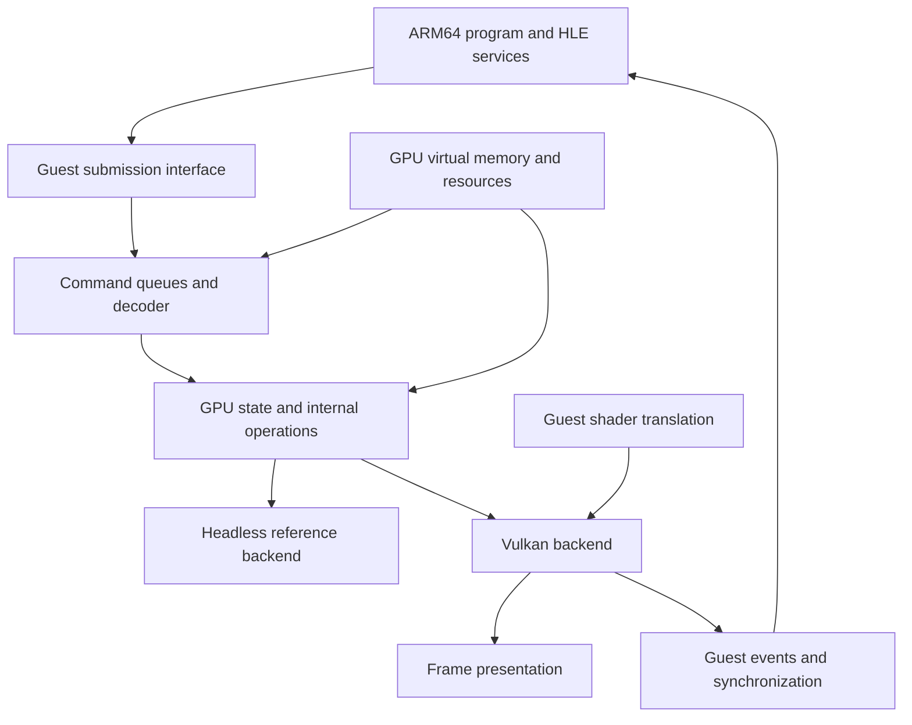

# Switch 2 GPU preparation

Follow-up: [guest-generated block-source conversion](LIBNX_GUEST_GPU_BLOCK_COPY.md) now validates two complete Fermi images through unchanged libnx transport, including byte/padding checks and independent physical/logical hashes. Normal runs have no command injection; display integration and wider layouts remain separate work.

Follow-up: [restricted block-linear source conversion](GPU_MAXWELL_BLOCK_SOURCE_COPY.md) now converts complete one-GOB-height Fermi images to pitched rows with full mapping validation and atomic publication. The new conversion tests inject synthetic commands; a guest-generated conversion remains the next proof.

Follow-up: [guest-generated pitched 2D copying](LIBNX_GUEST_GPU_COPY_2D.md) now validates two rectangular workloads through original libnx transport without normal-run host command injection. Separate negative tests verify missing-transfer and padding-corruption detection. Image layouts and rendering remain separate work.

Follow-up: [bounded pitched 2D copying](GPU_MAXWELL_PITCHED_COPY.md) now handles separate row strides while preserving padding and atomically publishing all rows. Its synthetic transport tests complement the unchanged single-line guest producer. An untouched guest-generated 2D workload remains the next integration proof.

Follow-up: [guest-generated copy and verification](LIBNX_GUEST_GPU_COPY.md) now exercises the linear-copy path from an ARM64 producer through unchanged libnx wrappers. The normal runs have no host command injection; a separate negative test checks that the guest detects a missing transfer.

Follow-up: [Maxwell linear DMA copy](GPU_MAXWELL_LINEAR_COPY.md) now copies a bounded byte range through class B0B5 and commits it together with replies and channel state. One transfer, disjoint mappings and the documented local launch form are supported; Ampere, image transfers and drawing remain separate milestones.

Follow-up: [modular profiles and exact-class dispatch](GPU_MODULAR_PROFILES.md) now separate profile capabilities, engine handlers and per-channel SET_OBJECT bindings. Maxwell remains the default; Ampere research classes are declared without executable behavior. Earlier fixed-subchannel restrictions below describe prior milestones.

Follow-up: [four-byte GPU semaphore release](GPU_MEMORY_RELEASE.md) now stages mapped-memory stores and commits them together with the replies and channel state. This remains a historical FIFO reference profile; image transfers, shaders and native Switch 2 validation remain separate work.

Follow-up: [synchronous channel reference submissions](GPU_DRIVER_REFERENCE_SUBMISSION.md) now execute the supported original Kickoff stream and publish per-channel state after the complete reply. Fences remain unchanged; there is no asynchronous queue, shader or rendering support. Earlier submission-refusal statements below are historical.

Follow-up: [local FIFO reference execution](GPU_REFERENCE_EXECUTION.md) now interprets SET_REFERENCE transactionally against caller-owned host state. Guest submissions remain refused; channel acknowledgement and completion semantics are the next integration boundary. Earlier no-execution statements below describe their original milestones.

Follow-up: [historical FIFO packet decoding](GPU_PACKET_DECODER.md) now produces method traces from owned snapshots, including a documented SET_REFERENCE reference. No method executes and no job is admitted; earlier decoder boundaries below describe the previous milestone.

Follow-up: [GPFIFO memory preflight](GPU_SUBMISSION_PREFLIGHT.md) now validates channel-owned mapped command ranges and creates temporary owned byte copies. Valid opaque input is still refused; the earlier transport-only outcome below is historical.

Follow-up: [nvIoctl2 transport validation](GPU_IOCTL2_TRANSPORT.md) now decodes the actual three-buffer request. KickoffPb remains unsupported and no job is admitted; earlier transport statements below describe the preceding milestone.

Follow-up: [original full channel initialization and priority](GPU_CHANNEL_INITIALIZATION.md) now validates nvGpuChannelCreate/Close. Submission transport is the next bounded milestone; earlier priority boundaries below describe previous snapshots.

Follow-up: [GPU error-notifier configuration](GPU_ERROR_NOTIFIER.md) now implements the observed enable/disable profile. SetPriority is the next unsupported boundary; earlier notifier statements below describe the previous milestone.

Follow-up: [GPU error-event query](GPU_ERROR_EVENT.md) now supports the original event-3 request and copied read handles. SetErrorNotifier is the next unsupported boundary; earlier event-query statements below describe the preceding milestone.

Follow-up: [historical graphics-context allocation](GPU_GRAPHICS_CONTEXT.md) now implements the observed AllocObjCtx profile. The GPU error-event query is the next unsupported boundary; earlier context-allocation statements below describe the previous milestone.

Follow-up: [bounded GPFIFO allocation](GPU_GPFIFO_ALLOCATION.md) now supports the observed AllocGpfifoEx2 profile. AllocObjCtx is the next unsupported boundary; earlier allocation statements below describe the preceding milestone.

Follow-up: [original channel/address-space binding](GPU_ADDRESS_SPACE_BINDING.md) now implements BindChannel. The next observed boundary is AllocGpfifoEx2; earlier next-step statements below describe the preceding milestone.

Follow-up: [original GPU channel lifecycle](GPU_CHANNEL_LIFECYCLE.md) now supports Open, SetNvmapFd and Close. Priority, address-space binding and command submission remain unsupported; earlier next-step statements below describe the preceding milestone.

Implementation follow-up: [synchronous GPU memory access](GPU_MEMORY_ACCESS.md) now resolves live mappings to CPU backing for validated reads and writes. No commands are executed; channel lifecycle is the next bounded milestone.

Implementation follow-up: [Nvmap-backed GPU mappings](LIBNX_GPU_MAPPINGS.md) now adds bounded automatic/fixed associations, metadata translation and backing-retention guards. Command consumption, channels and native Switch 2 validation remain separate work; earlier boundary statements below are historical.

Implementation follow-up: [GPU virtual reservations](LIBNX_GPU_VIRTUAL_ALLOCATIONS.md) now supports bounded original AllocSpace/FreeSpace calls. Nvmap mappings, channels and GPU command execution remain unsupported; older boundary statements below describe prior milestones.

Implementation follow-up: [original GPU address-space lifecycle](LIBNX_GPU_ADDRESS_SPACE.md) now validates typed Open/InitializeEx/Close with the unchanged reference client. GPU VA allocations, mappings and command submission remain unsupported. Source-audit statements below describe their earlier snapshot.

October 27 follow-up: [submission path audit](GPU_SUBMISSION_AUDIT.md) identifies the pinned original client's address-space/channel dependencies and the class boundary. The first proposed executable GPU milestone is an original address-space lifecycle reference, before command decoding or Vulkan. The earlier research plan below remains a roadmap, not an implementation claim.

Status on October 24, 2026: design and research. No guest GPU or Vulkan backend is implemented. The October 25 [development graphics output](HLE_GRAPHICS.md) captures CPU-produced RGB pixels and exports PNG files; it validates the CPU/memory/services/files chain, not guest command decoding or shaders.

## Documented starting point

NVIDIA's 3D class inventory associates **AMPERE_B**, **clc797.h / clc797tex.h**, and **T239** [G1]. This is a concrete basis for studying 3D methods and texture descriptors. It does not specify game startup, Switch 2 driver integration or all shaders.

Community NV services documentation describes Switch driver and submission operations [G2]. Its exact coverage of native Switch 2 applications remains to be established. Documented structures, implementation and reference validation are distinct stages.

Vulkan is the proposed PC backend. Its dependency and memory-visibility rules require explicit handling [G3]; translating draw calls alone cannot ensure correct data visibility.

## Proposed architecture

This proposes code boundaries; it does not claim to represent every internal console layer.

| Component | Responsibility | Initial evidence |
| --- | --- | --- |
| GPU memory | Separate CPU/GPU addresses, mappings, bounds, resources and CPU modifications | Tested reads/writes and aliases; no blind conversion to host pointers |
| Submission | Receive a buffer through an identified guest interface | Validated structure and lifetime |
| Decoder | Read bounded packets and methods | Exact reference-stream consumption; explicit rejection of unknown/truncated packets |
| Graphics state | Record registers and translate understood operations into an internal representation | Deterministic state from a documented stream |
| Shaders | Identify guest representation and translate a subset to SPIR-V | Minimal shader with known inputs/outputs; unknown instructions reported |
| Resources | Buffers, textures, formats and memory-layout conversion | Verified pixel patterns before complex rendering |
| Synchronization | Connect GPU jobs, memory results and CPU events | Wait/signal without lost events or early reads |
| Vulkan backend | Execute supported internal operations | Reproducible rendering with available Vulkan validation enabled |
| Presentation | Export and display a frame | Frame produced by identified guest commands, with checked dimensions |

A hand-written backend C/GLSL shader does not validate guest shader translation.

## Initial implementation order

1. Identify classes actually used by a native target or trace; revisit AMPERE_B assumptions if evidence differs.
2. Describe offline captures: provenance, version, virtual addresses, necessary buffers, commands and expected results. Label fabricated streams synthetic.
3. Add GPU memory and a bounded decoder independently of Vulkan. Start with a small documented stream; test effects and errors with the reference backend.
4. Implement a simple copy or clear only after its encoding is established. Check resulting bytes; this alone is not a compatible GPU.
5. Add Vulkan, then the target's first shader/draw path. Validate memory and synchronization before performance caches.
6. Connect the tested path to HLE services and presentation, and compare its frame with the reference.

Guest interfaces, packet formats, shader instructions and native presentation are not resolved by this plan. CPU development can proceed alongside their research.

## Criteria for claiming a first Switch 2 rendering

An identified native target/trace with provenance and version; guest commands/resources consumed by our decoder; actual guest shader support when needed; comparison against a reference with stated limitations. A Vulkan window, a host-generated triangle or register constants alone do not qualify.

## Sources

- [G1 — NVIDIA 3D classes](https://github.com/NVIDIA/open-gpu-doc/blob/master/classes/3d/README.txt) and [AMPERE_B header](https://github.com/NVIDIA/open-gpu-doc/blob/master/classes/3d/clc797.h). Manufacturer source, evolving branch, consulted October 24, 2026.
- [G2 — SwitchBrew NV services](https://switchbrew.org/wiki/NV_services). Community research; verify applicability to S2 separately.
- [G3 — Khronos Vulkan synchronization](https://docs.vulkan.org/spec/latest/chapters/synchronization.html). Host-backend specification, not a guest GPU specification.
