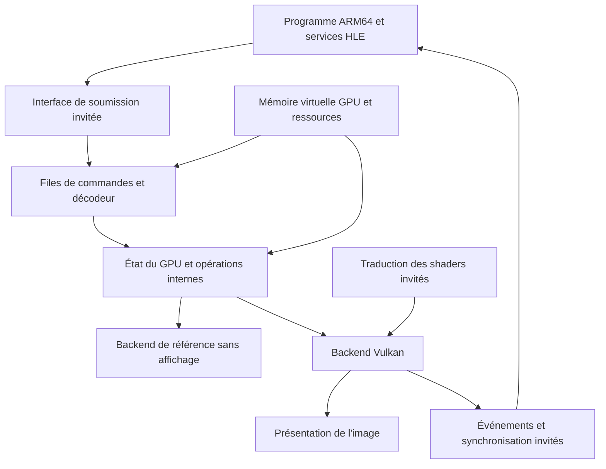

# Préparation du GPU Switch 2

État au 24 octobre 2026 : conception et recherche. Aucun GPU invité ni backend Vulkan n'est encore implémenté dans le projet.

Mise à jour du 25 octobre : une [sortie graphique de développement](HLE_GRAPHICS.md) capture les pixels RGB produits par un programme ARM64 et les exporte en PNG. Elle valide la chaîne CPU/mémoire/services/fichiers ; le décodeur de commandes GPU et les shaders décrits ci-dessous restent à construire.

## Point de départ documenté

La liste de classes 3D publiée par NVIDIA associe **AMPERE_B**, les en-têtes **clc797.h / clc797tex.h**, et le **T239** [G1]. C'est une base concrète pour étudier les méthodes du moteur 3D et les descripteurs de textures. Cela ne décrit pas à lui seul le démarrage d'un jeu, l'intégration du pilote Switch 2 ou la totalité des shaders.

La documentation communautaire NV services décrit des opérations de pilote et de soumission dans l'écosystème Switch [G2]. Sa couverture exacte du chemin utilisé par une application native Switch 2 reste à établir. Il faut distinguer présence de structures documentées, prise en charge par notre code et validation sur une référence.

Vulkan sera le backend PC proposé. Ses règles exigent de gérer explicitement les dépendances et la visibilité mémoire [G3]. Une simple traduction des appels de dessin serait insuffisante si les données ne sont pas visibles au bon moment.

## Architecture proposée

Ce schéma est une proposition de séparation du code ; il ne prétend pas représenter toutes les couches internes de la console.

## Composants à concevoir

| Composant | Responsabilité | Première preuve attendue |
| --- | --- | --- |
| Mémoire GPU | Distinguer adresses CPU/GPU, mappings, limites, ressources et modifications CPU | Lecture/écriture et alias de mémoire testés, aucune conversion aveugle en pointeur PC |
| Soumission | Recevoir un buffer selon une interface invitée identifiée | Structure et durée de vie des buffers vérifiées |
| Décodeur | Lire les paquets et méthodes avec tailles et limites contrôlées | Consommation exacte d'un flux de référence ; arrêt explicite sur paquet inconnu ou tronqué |
| État graphique | Stocker les registres et convertir les opérations comprises vers une représentation interne | État déterministe obtenu à partir d'un flux documenté |
| Shaders | Identifier la représentation invitée et traduire un sous-ensemble vers SPIR-V | Shader minimal avec entrée/sortie connues ; instruction inconnue signalée |
| Ressources | Gérer buffers, textures, formats et conversions de disposition mémoire | Motifs de pixels vérifiés avant tout rendu complexe |
| Synchronisation | Relier les travaux GPU, résultats mémoire et événements attendus par le CPU | Attente/signal sans perte d'événement ni lecture prématurée |
| Backend Vulkan | Exécuter les opérations internes supportées | Rendu reproductible avec contrôles Vulkan activés lorsqu'ils sont disponibles |
| Présentation | Exporter une image puis l'afficher | Image issue de commandes invitées identifiées et dimensions vérifiées |

Ne pas confondre shader C/GLSL du backend et shader produit pour le GPU invité. Les deux formats demandent une étape de traduction ; un shader PC écrit à la main ne valide pas cette étape.

## Ordre des premiers travaux GPU

1. Identifier et consigner les classes effectivement utilisées par une cible ou une trace native ; réviser les hypothèses si elles diffèrent d'AMPERE_B.
2. Décrire le format de capture hors ligne : origine, version, adresses virtuelles, buffers nécessaires, commandes et résultat attendu. Un flux fabriqué pour un test doit être nommé synthétique.
3. Introduire la mémoire GPU et un décodeur limité, indépendant de Vulkan. Commencer par un petit flux documenté ; vérifier ses effets et ses erreurs avec le backend de référence.
4. Faire fonctionner une opération simple de copie ou d'effacement si son encodage est établi. Vérifier les octets produits ; ne pas annoncer un GPU compatible sur cette seule base.
5. Ajouter le backend Vulkan puis le premier chemin de shaders et de dessin de la cible. Valider la mémoire et la synchronisation avant les caches de performances.
6. Relier le chemin testé aux services HLE et à la présentation ; comparer une image produite au résultat de référence.

L'interface invitée, le format des paquets, le jeu d'instructions shader et le mécanisme de présentation natif ne sont pas considérés comme résolus par ce document. Le premier chantier CPU peut continuer pendant leur recherche.

## Critères avant de dire « premier rendu Switch 2 »

- Cible ou trace native identifiée, avec provenance et version.
- Commandes et ressources invitées consommées par notre décodeur.
- Shaders invités effectivement pris en charge si le dessin en utilise.
- Résultat comparé à une référence et limites décrites.

Une fenêtre Vulkan, un triangle généré directement sur PC ou la présence de constantes de registres dans le code ne suffisent pas à remplir ces critères.

## Sources

- [G1 — NVIDIA, classes 3D](https://github.com/NVIDIA/open-gpu-doc/blob/master/classes/3d/README.txt) et [en-tête AMPERE_B](https://github.com/NVIDIA/open-gpu-doc/blob/master/classes/3d/clc797.h). Source du constructeur ; branche évolutive, consultée le 24 octobre 2026.
- [G2 — SwitchBrew, NV services](https://switchbrew.org/wiki/NV_services). Recherche communautaire ; ne pas appliquer toutes les entrées à S2 sans vérification.
- [G3 — Khronos, synchronisation Vulkan](https://docs.vulkan.org/spec/latest/chapters/synchronization.html). Spécification du backend hôte, pas du GPU invité.
